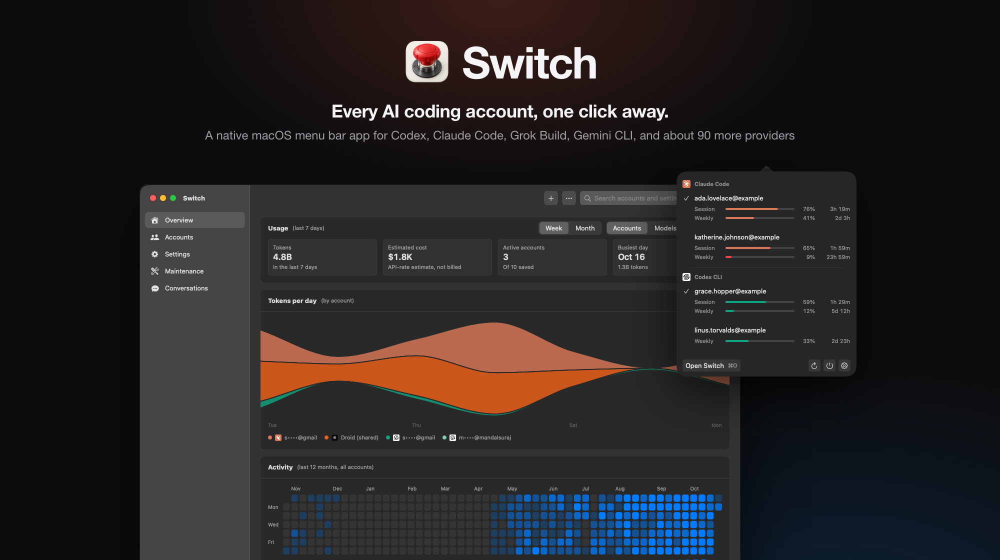
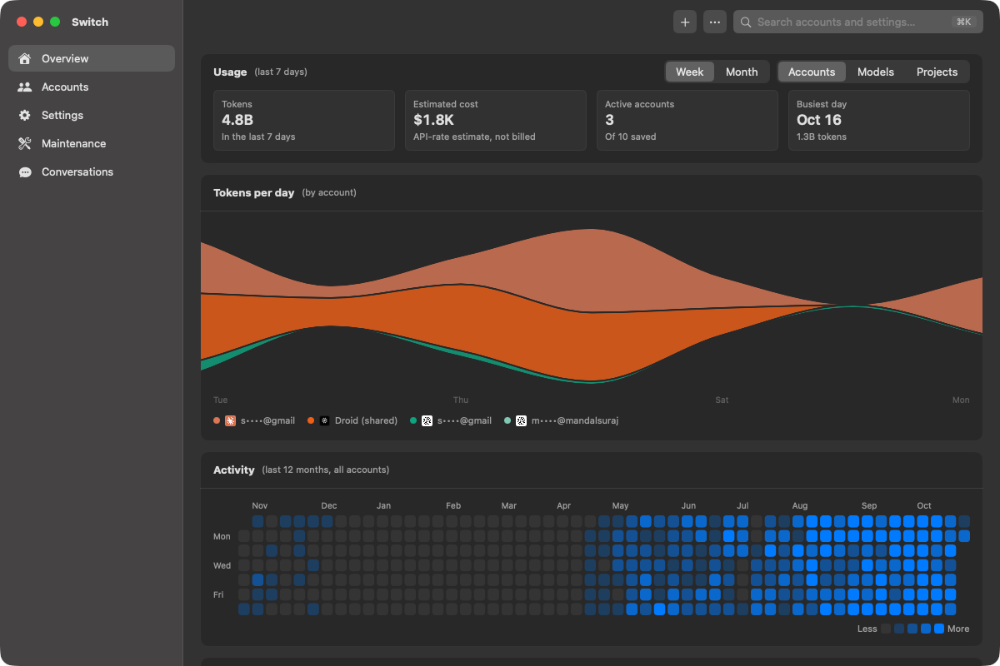
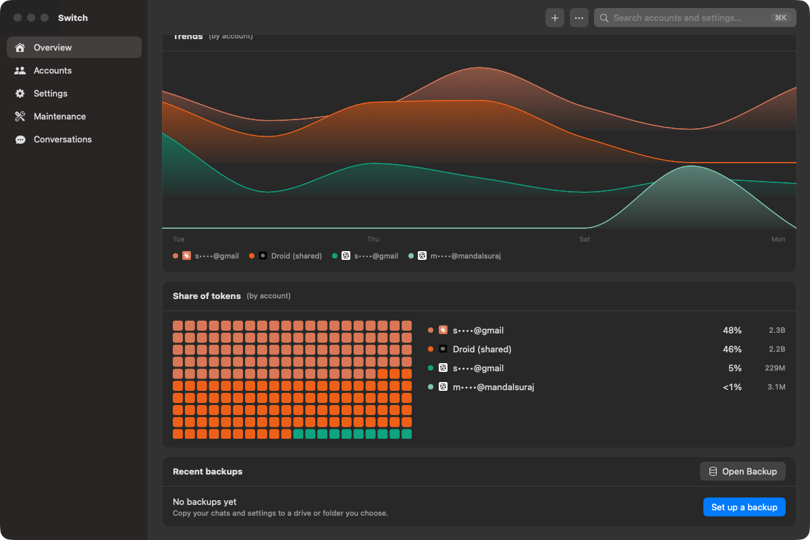
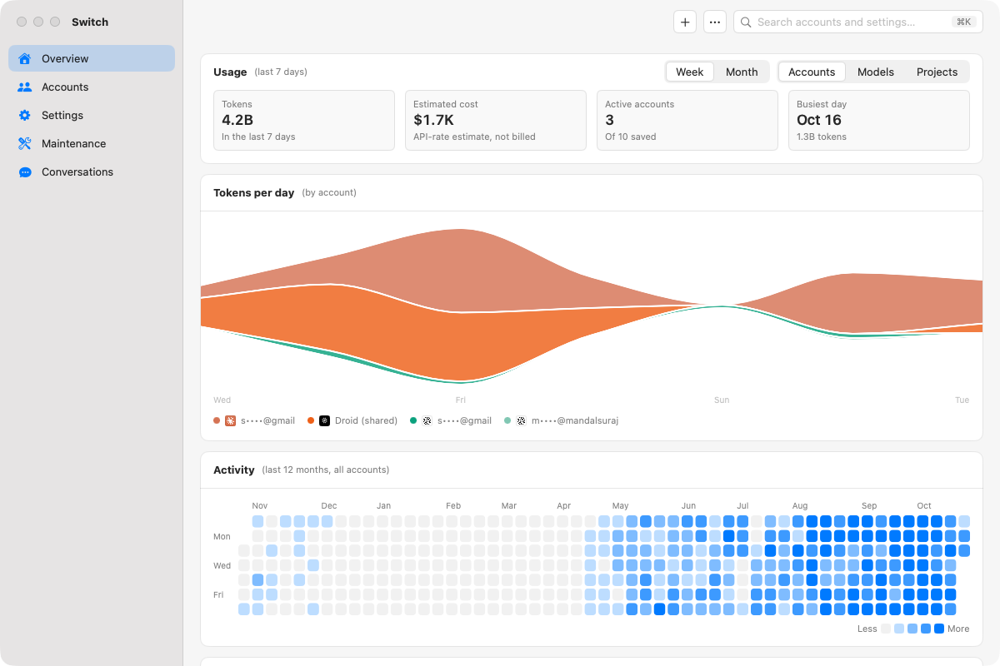
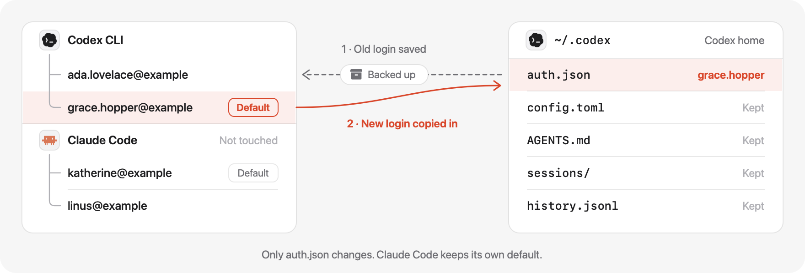

<p align="center">
  
</p>

<p align="center">
  <b>Switch AI accounts without signing in over and over.</b><br>
  A native macOS menu bar app that keeps every login for your AI coding tools ready,
  shows how much of each limit is left, and opens the right tool with one click.
</p>

<p align="center">
  <a href="https://github.com/surajmandalcell/switch/releases/latest"></a>
  
  
  <a href="https://www.npmjs.com/package/@smdl/switch"></a>
  <a href="LICENSE"></a>
</p>

<p align="center">
  <a href="https://github.com/surajmandalcell/switch/releases/latest"><b>Download for Mac</b></a> ·
  <a href="#use-switch-in-the-terminal">Terminal</a> ·
  <a href="#supported-tools">Supported tools</a> ·
  <a href="docs/development.md#build-and-check">Build from source</a>
</p>

## Why Switch

- **One click to change accounts.** Pick an account in the menu bar. Switch replaces only that
  tool's login, so settings, extensions, and history stay where they are.
- **See every limit before you hit it.** Session and weekly windows, reset countdowns, and a pace
  color for each account, across about 95 tools and API providers.
- **Know where your tokens go.** The Overview page charts tokens per day, a year of activity,
  trends per account, and an estimated API cost.
- **Safe by design.** Sign-in runs in a private temporary home. The old login is saved and the
  replaced bytes are backed up before every switch. Switch never reads the macOS Keychain or
  browser cookie stores.

## Overview

Every account, model, and project on one page: tokens per day, a 12-month activity map, trends,
and each account's share of tokens.



| Trends | Light mode |
| :---: | :---: |
|  |  |

## Menu bar

The status item shows up to six account percentages. The popover lists every saved account,
the default for each tool, its limits, and when each window resets. Drag a service header to
change the order of the popover, the Accounts page, and the status item. Hover a header and
use the eye button to hide that service from the status item. Optional notifications warn when
a window is almost out, and a dot marks a provider incident.

| Light mode | Dark mode |
| :---: | :---: |
|  |  |

## Accounts

All saved accounts, grouped by tool, with live usage and one button to make any of them the default.


<sub>Screenshots show real usage with <b>Hide email addresses</b> on. The menu bar screenshots use Preview sample data.</sub>

## Get Switch for Mac

1. [Download the latest release](https://github.com/surajmandalcell/switch/releases/latest)
   and unzip it.
2. Move `Switch.app` to Applications and open it.
3. Install the command-line tool for each provider you use.

Switch requires macOS 14 or later on Apple Silicon.

## Start switching

Choose **Add Account**, then search for the provider.

1. For a command-line tool, sign in through its private temporary home, or
   import the login you already have. For an API provider, paste its key.
2. Return to Switch and choose **Check Now**.
3. Choose **Switch** in the menu bar, or **Make Default** in the app.
4. Choose **Open Codex** (or your tool's name) to start the tool with that account.

Adding an account never replaces the login you use now.

## Supported tools

| Tool | Switching | Usage |
| --- | --- | :---: |
| Codex CLI | Swaps `~/.codex/auth.json` | Yes |
| [Grok Build](https://github.com/xai-org/grok-build#installing-the-released-binary) | Swaps `~/.grok/auth.json` | Yes |
| Claude Code | One profile per account, shared history | Yes |
| Droid (Factory) | Swaps the auth files in `~/.factory` | Yes |
| 12 more command-line tools | Swaps only the tool's login | Yes |
| About 80 API and plan providers | Switches the saved key or session | Yes |

**Command-line tools:** Gemini CLI, Antigravity CLI, Cursor, GitHub Copilot, Kiro, Kimi Code,
Kilo, Codebuff, Devin, OpenCode Go, Ollama, and Vertex AI.

**API and plan providers:** OpenRouter, z.ai, DeepSeek, MiniMax, Mistral, Groq, OpenAI,
AWS Bedrock, Warp, Factory, and more.

Switch includes every usage provider from [OpenUsage](https://github.com/robinebers/openusage)
and [CodexBar](https://github.com/steipete/CodexBar) that works without the macOS Keychain
or browser cookie stores. A provider that needs a browser session takes a pasted Cookie
header instead. Codex usage refreshes every 3 minutes, and other providers every 5.

## Only the provider login changes

Switch keeps each provider's settings, extensions, and work history in its shared home.
Selecting an account changes only that provider's credential file, JSON entry, or
database rows. The previous login is saved first, and the replaced bytes are backed up.
Each provider keeps its own default account.

<picture>
  <source media="(prefers-color-scheme: dark)" srcset="docs/screenshots/login-swap-dark.png">
  
</picture>

<details>
<summary><b>Provider notes</b></summary>

- **Codex CLI:** Switch replaces only `~/.codex/auth.json`. Open sessions keep the
  login they already loaded. Usage, history, activity, imports, and Cleanup are
  available.
- **Grok Build:** Switch replaces only `~/.grok/auth.json`. The official CLI reloads that
  file before its next API call.
- **Claude Code:** Each account is a separate profile with its own
  `CLAUDE_CONFIG_DIR`, so several can stay signed in. All profiles share the
  conversations, settings, commands, and skills in `~/.claude`. The default applies to
  sessions launched through Switch. Turn on **Use the selected Claude account in
  terminals** in Settings to make a plain `claude` command follow it.
- **Droid:** Switch replaces only the auth files in `~/.factory`, and asks first while
  Droid or Factory.app is running. A mission stays with the account that started it, so
  **Resume** on the Accounts page switches to that account first.
- **Other command-line tools:** Switch swaps only the tool's login file, JSON entry, or
  database rows. Quit an app such as Cursor before switching it.
- **API providers:** Each account is a saved key or pasted session. Switching changes the
  default that the menu bar shows.

</details>

## Use Switch in the terminal

Open the terminal interface without a global install:

```bash
npx --yes @smdl/switch
```

Or install it globally:

```bash
npm install --global @smdl/switch
switch
```

The terminal interface uses the same account store and switching engine as the
Mac app. Use the arrow keys to move, Enter to select, and Escape to go back.
The npm build supports Apple Silicon Macs. From a source checkout, run `make tui`.
The `ai-manager` command remains available as an alias.

Script it:

```bash
switch usage --json                               # usage for every account
switch guard --provider codex --min-remaining 10  # fails when a window runs low
switch help                                       # every non-interactive command
```

## More features

- **Check a saved account.** Test its login without making it the default, and refresh
  its usage.
- **Import an existing account.** Review a login or provider home before you add it.
  Settings and history are optional.
- **Search your history.** Search conversations, grouped by day, and track daily tokens
  per account, model, and project.
- **Clean up and back up.** Preview conversations and caches, move them to a recoverable
  trash, and restore them when needed. Filter conversations by date, project, tool, and
  title before you remove them. Back up chats and settings to a drive or folder you choose,
  or back up only your own prompts as Markdown, one folder per project.
- **Keep your screen private.** Hide email addresses, or turn on Privacy mode to show every
  account under a stable made-up name.

## Development

- [Build and check](docs/development.md#build-and-check) from source.
- Try the [isolated Preview build](docs/development.md#preview-with-sample-accounts) with
  sample accounts and no real credentials.
- The [product specification](specs/product.md) defines current behavior.
- [Security policy](SECURITY.md) · [Release notes](docs/release-notes.md)

## License

[MIT](LICENSE)
