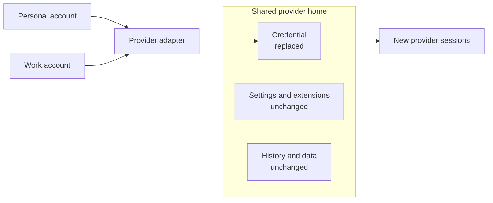

<p align="center">
  
</p>

<p align="center">
  <b>Switch AI accounts without signing in over and over.</b><br>
  A native macOS menu bar app that keeps every login for your AI coding tools ready,
  shows how much of each limit is left, and opens the right tool with one click.
</p>

<p align="center">
  <a href="https://github.com/surajmandalcell/switch/releases/latest"></a>
  
  
  <a href="https://www.npmjs.com/package/@smdl/switch"></a>
  <a href="LICENSE"></a>
</p>

<p align="center">
  <a href="https://github.com/surajmandalcell/switch/releases/latest"><b>Download for Mac</b></a> ·
  <a href="#use-switch-in-the-terminal">Terminal</a> ·
  <a href="#supported-tools">Supported tools</a> ·
  <a href="docs/development.md#build-and-check">Build from source</a>
</p>

## Why Switch

- **One click to change accounts.** Pick an account in the menu bar. Switch replaces only that
  tool's login, so settings, extensions, and history stay where they are.
- **See every limit before you hit it.** Session and weekly windows, reset countdowns, and a pace
  color for each account, across about 95 tools and API providers.
- **Know where your tokens go.** The Overview page charts tokens per day, a year of activity,
  trends per account, and an estimated API cost.
- **Safe by design.** Sign-in runs in a private temporary home. The old login is saved and the
  replaced bytes are backed up before every switch. Switch never reads the macOS Keychain or
  browser cookie stores.

## Overview

Every account, model, and project in one page: tokens per day, a 12-month activity map, trends,
and each account's share of tokens.


| Trends and share of tokens | Light appearance |
| :---: | :---: |
|  |  |

## Menu bar

The status item shows up to four account percentages. The popover lists every saved account,
the default for each tool, its limits, and when each window resets. Optional notifications
warn when a window is almost out, and a dot marks a provider incident.

| Light | Dark |
| :---: | :---: |
|  |  |

## Accounts

All saved accounts, grouped by tool, with live usage and one button to make any of them the default.


<sub>Screenshots show real usage with <b>Hide email addresses</b> turned on. Menu bar screenshots use the synthetic Preview data.</sub>

## Get Switch for Mac

1. [Download the latest release](https://github.com/surajmandalcell/switch/releases/latest)
   and unzip it.
2. Move `Switch.app` to Applications and open it.
3. Install the command-line tool for each provider you use.

Switch requires macOS 14 or later on Apple Silicon.

## Start switching

Choose **Add Account**, then search for the provider.

1. For a command-line tool, sign in through its isolated temporary home, or
   import the login you already have. For an API provider, paste its key.
2. Return to Switch and choose **Check Now**.
3. Choose **Switch** in the menu bar, or **Set as Default** in the app.
4. Choose **Open** to launch that provider with the selected account.

Sign-in runs in a private temporary home. It does not replace your current
login while you add another account.

## Supported tools

| Provider | Account switching | Usage limits |
| --- | --- | --- |
| Codex CLI | Swaps `~/.codex/auth.json` | Supported |
| [Grok Build](https://github.com/xai-org/grok-build#installing-the-released-binary) | Swaps `~/.grok/auth.json` | Supported |
| Claude Code | Profiles that share one history | Supported |
| Droid (Factory) | Swaps the Droid login | Supported |
| Gemini CLI, Antigravity CLI, Cursor, GitHub Copilot, Kiro, Kimi Code, Kilo, Codebuff, Devin, OpenCode Go, Ollama, Vertex AI | Swaps only the tool's login | Supported |
| About 80 API and plan providers, such as OpenRouter, z.ai, DeepSeek, MiniMax, Mistral, Groq, OpenAI, AWS Bedrock, Warp, and Factory | Switches the saved key or session | Supported |

Switch includes every usage provider from [OpenUsage](https://github.com/robinebers/openusage)
and [CodexBar](https://github.com/steipete/CodexBar) that works without reading the
macOS Keychain or browser cookie stores. Providers that need a browser session take a
pasted Cookie header instead. Codex refreshes every three minutes and other providers
every five.

## Only the provider login changes

Switch keeps each provider's settings, extensions, and work history in its shared home.
Selecting an account changes only that provider's credential file, JSON entry, or
database rows. The previous login is saved first, and the replaced bytes are backed up.
Each provider keeps its own default account.



<details>
<summary><b>Provider notes</b></summary>

- **Codex CLI:** Switch replaces only `~/.codex/auth.json`. Existing sessions keep the
  credential they already loaded. Usage limits, history, activity, imports, and Cleanup
  are available.
- **Grok Build:** Switch replaces only `~/.grok/auth.json`. The official CLI reloads that
  file before its next API call.
- **Claude Code:** Each account is a separate profile with its own
  `CLAUDE_CONFIG_DIR`, so several can stay signed in. All profiles share the
  conversations, settings, commands, and skills in `~/.claude`. The default applies to
  sessions launched through Switch. Turn on **Use the selected Claude account in
  terminals** in Settings to make a plain `claude` command follow it.
- **Other command-line tools:** Switch swaps only the tool's login file, JSON entry, or
  database rows. Quit an app such as Cursor before switching it.
- **API providers:** Each account is a saved key or pasted session. Switching changes the
  default that the menu bar shows.

</details>

## Use Switch in the terminal

Open the terminal interface without a global install:

```bash
npx --yes @smdl/switch
```

Or install it globally:

```bash
npm install --global @smdl/switch
switch
```

The terminal interface uses the same account store and switching engine as the
Mac app. Use the arrow keys to move, Enter to select, and Escape to go back.
The npm build supports Apple Silicon Macs. From a source checkout, run `make tui`.
The `ai-manager` command remains available as an alias.

Script it:

```bash
switch usage --json                                  # every account's limits
switch guard --provider codex --min-remaining 10     # exits non-zero when a window runs low
switch help                                          # all non-interactive commands
```

## More when you need it

- **Check a saved account.** Validate its credential without making it the default, and
  refresh usage when the provider exposes it.
- **Import an existing account.** Review a credential or provider home before adding it.
  Extra settings and history remain optional where supported.
- **Explore supported history.** Search conversations, track daily token activity, and
  retain summaries when the provider supplies compatible data.
- **Clean up and back up safely.** Preview supported conversations and caches, move them to
  recoverable trash, and restore them when needed. Back up chats and settings to a drive
  or folder you choose.
- **Keep your screen private.** Hide email addresses, or turn on Privacy mode to show every
  account under a stable made-up name.

## Development

- [Build and check](docs/development.md#build-and-check) from source.
- Try the [isolated Preview build](docs/development.md#preview-with-sample-accounts) with
  sample accounts and no real credentials.
- The [product specification](specs/product.md) defines current behavior.
- [Security policy](SECURITY.md) · [Release notes](docs/release-notes.md)

## License

[MIT](LICENSE)
