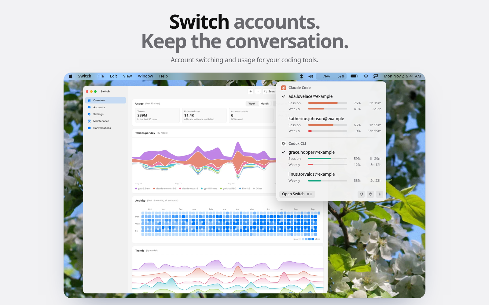
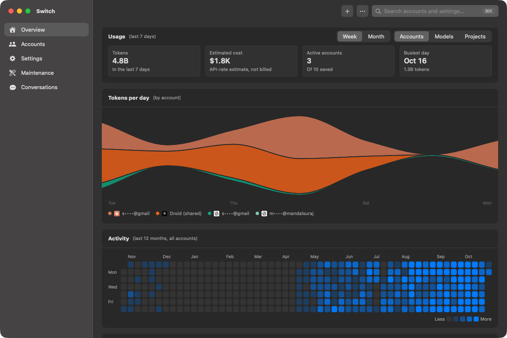
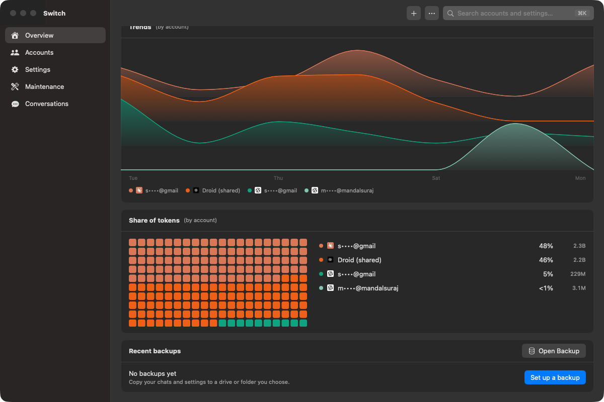
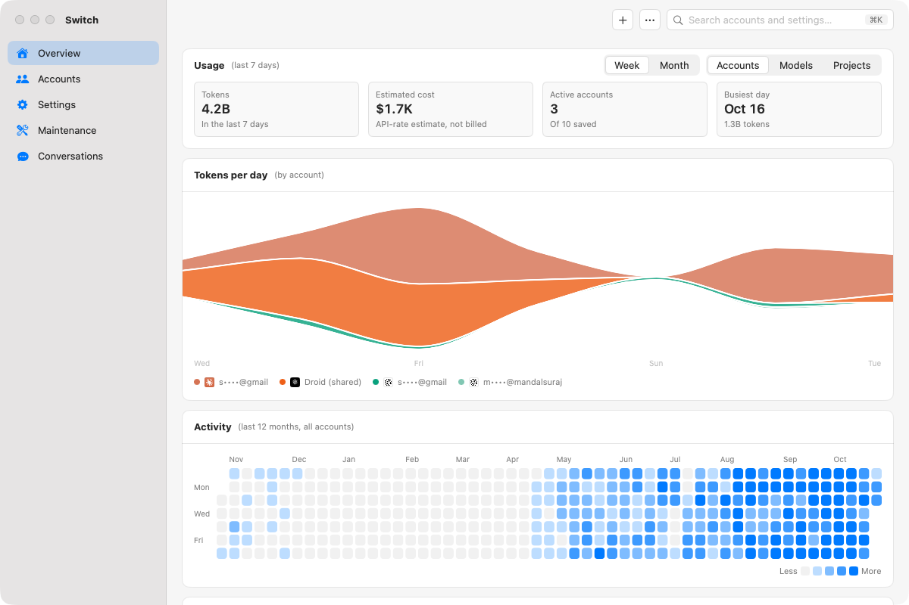
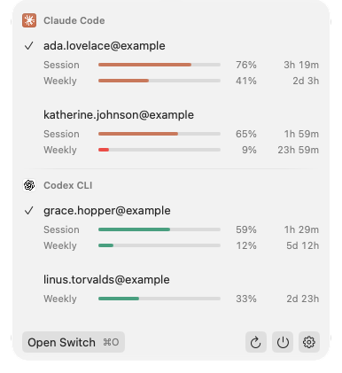
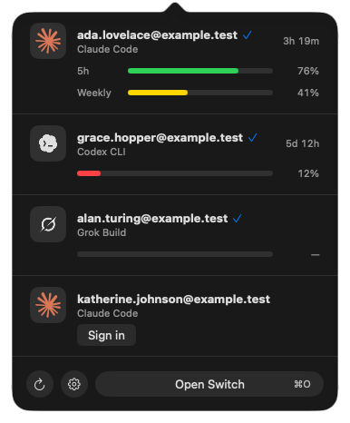
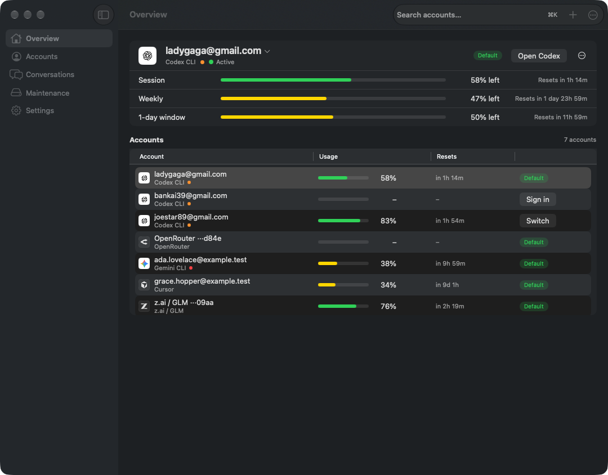

<p align="center">
  
</p>

# Switch

Account switching and usage for AI coding tools. A native macOS app with a menu bar popover and a terminal interface.

Save accounts, check their limits, and choose which account a supported tool uses. Keep local settings and conversations in place when you switch. Access to cloud conversations still belongs to the provider account.

**[Download for Mac](https://github.com/surajmandalcell/switch/releases/latest)** · [Website](https://switch.mandalsuraj.com) · [Terminal](#use-switch-in-the-terminal) · [Build from source](docs/development.md#build-and-check)

## Get started

Requires **macOS 14 or later and Apple Silicon**.

1. Download the latest release, unzip it, and move `Switch.app` to Applications.
2. Open Switch and choose **Add Account**. Search for the tool or provider you use.
3. Follow its sign-in flow, import an existing login, or enter an API key. Adding an account keeps your current login active.
4. Choose **Check Now** to load usage. For tools with account switching, choose **Switch** in the menu bar or **Make Default** in the app.

Install each coding tool separately. Use its **Open** action in Switch to launch it with the selected account.

## Usage at a glance

See account limits and reset times in the menu bar. The Overview page shows daily tokens, activity, account trends, and estimated API costs.



| Account trends | Light appearance |
| :---: | :---: |
|  |  |

| Menu bar in light mode | Menu bar in dark mode |
| :---: | :---: |
|  |  |

Manage saved accounts by tool, check usage without switching, and set a default for each tool.



<sub>App screenshots show real usage with email addresses hidden. Menu bar screenshots use Preview sample data.</sub>

## Accounts and access

Switch changes the selected tool's login while preserving its local settings and workspace data. It saves the outgoing login and backs up replaced data. Each tool has its own default account.

| Tool or provider | What selecting an account does |
| --- | --- |
| Codex CLI | Replaces its auth file. Running sessions may need to reopen to use the new account. |
| Grok Build | Replaces its auth file, which the CLI reloads before its next API call. |
| Claude Code | Uses a separate account profile with shared local conversations and settings. The default applies to launches through Switch; optional terminal integration also covers plain `claude` commands. |
| Droid / Factory | Replaces auth files and updates eligible local conversation headers for the selected organization. Original session IDs and message bodies remain intact. Active writers defer this step until a safe retry. |
| File-backed integrations, including Gemini CLI, Cursor, Kimi Code, and Kiro | Change only the selected tool's supported auth files or entries. Support differs by client; Cursor editor switching does not switch Cursor CLI. Quit the affected app before switching. |
| API-key and session providers | Save credentials and check usage. Selecting a default does not generally change a coding tool's login. |

Local history and cloud access are separate. Droid cloud missions stay with their owner. Codex account rules can restrict which conversations a different account can resume. Other tools can also require the original account for cloud history or attachments.

See [conversation continuity and tool limits](specs/conversation-continuity.md) for the detailed support table. The [website](https://switch.mandalsuraj.com) lists providers; the terminal's provider list reflects your installed version.

## Use Switch in the terminal

Run without a global install:

```bash
npx --yes @smdl/switch
```

Or install and update globally:

```bash
npm install --global @smdl/switch@latest
switch
```

The terminal uses the same account store and switching engine as the Mac app. Use arrow keys to move, Enter to select, and Escape to go back. `ai-manager` is also available as an alias.

```bash
switch --version
switch providers
switch usage --json
switch guard --provider codex --min-remaining 10
switch help
```

The npm package supports Apple Silicon Macs only. The shared core and CLI also run on Linux when [built from source](docs/development.md#build-and-check). Run `make tui` from a source checkout to start the terminal interface.

## History, backups, and privacy

Search local conversations and review token use by account, model, or project. Preview Cleanup changes before moving conversations and caches to recoverable trash. Back up chats and settings to a folder or drive, or export your prompts as Markdown.

Hide email addresses or use Privacy mode for stable account aliases. Switch does not read the macOS Keychain or browser cookie stores. Providers that need a browser session accept a pasted session instead.

## Documentation and credits

[Build and check](docs/development.md#build-and-check) · [Product specification](specs/product.md) · [Security policy](SECURITY.md) · [Release notes](docs/release-notes.md)

Usage integrations include work adapted from [OpenUsage](https://github.com/robinebers/openusage) and [CodexBar](https://github.com/steipete/CodexBar).

Switch is released under the [MIT license](LICENSE).
