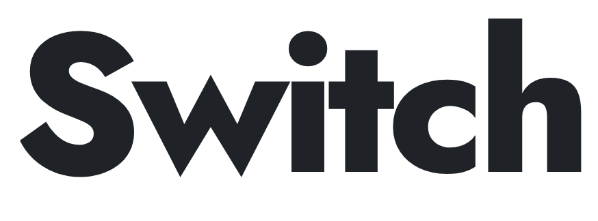
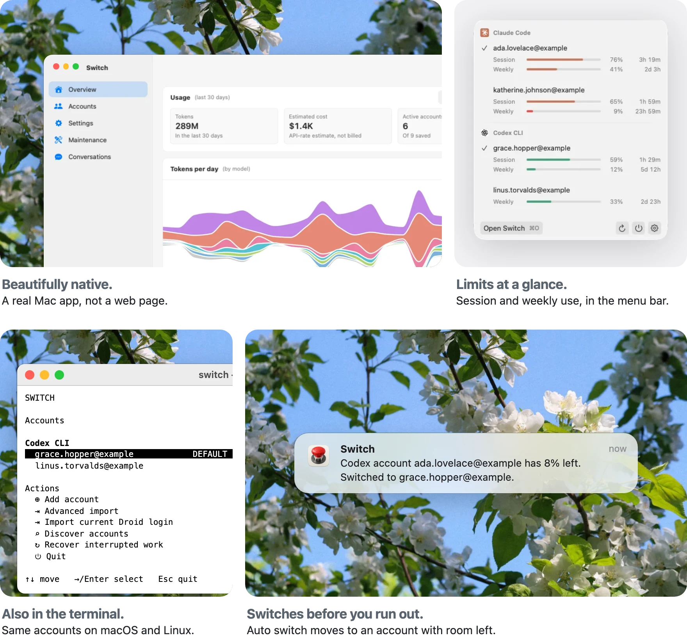

<p align="center">
  <picture>
    <source media="(prefers-color-scheme: dark)" srcset="docs/readme/icon-dark.png">
    
  </picture>
</p>

<p align="center">
  <picture>
    <source media="(prefers-color-scheme: dark)" srcset="docs/readme/wordmark-dark.png">
    
  </picture>
</p>

<p align="center">
  <b>Coding accounts and usage. Right in your menu bar.</b><br>
  Works with Codex, Claude Code, Droid, Gemini CLI, and more.
</p>

<p align="center">
  <a href="https://github.com/surajmandalcell/switch/releases/latest"><b>Download for Mac</b></a> &nbsp;·&nbsp;
  <a href="https://switch.mandalsuraj.com">Website</a> &nbsp;·&nbsp;
  <a href="#installation">Installation</a> &nbsp;·&nbsp;
  <a href="https://github.com/surajmandalcell/switch/issues">Report a problem</a>
</p>

<p align="center">
  <picture>
    <source media="(prefers-color-scheme: dark)" srcset="docs/readme/bento-dark.webp">
    
  </picture>
</p>

## Why Switch

Switch keeps your coding accounts in one place and shows how much each one has left.

- **Quick.** Pick an account in the menu bar. Switch changes that tool's login for you.
- **Careful.** It saves the old login and backs up what it replaces. Settings and local conversations stay.
- **Clear.** See limits, reset times, and token use for every account.
- **Private.** Hide email addresses or turn on Privacy mode. Switch does not read browser cookie stores.
- **Native.** A small Mac app, plus a terminal app for macOS and Linux.

There is more: search local conversations, preview Cleanup before it moves anything to the trash, and back up chats and settings.

## Installation

<details open>
<summary><b>Mac</b> (Apple silicon, macOS 14 or later)</summary>

<br>

Run this in Terminal:

```sh
curl -fsSL https://raw.githubusercontent.com/surajmandalcell/switch/master/install.sh | sh
```

It installs the Mac app and the Switch CLI. Run it again to update.

Or [download the `.dmg`](https://github.com/surajmandalcell/switch/releases/latest), open it, and drag **Switch** to **Applications**.

Then:

1. Open Switch, or run `~/.local/bin/switch` in a terminal.
2. Choose **Add Account** and follow the sign-in steps for your tool.
3. Check usage and choose the account you want to use.

</details>

<details>
<summary><b>Linux</b> (x86_64)</summary>

<br>

Run this in a terminal:

```sh
curl -fsSL https://raw.githubusercontent.com/surajmandalcell/switch/master/install.sh | sh
```

It installs the Switch CLI, a full terminal app, in `~/.local/bin`. Run it again to update.

Then run `switch`, choose **Add Account**, and follow the sign-in steps for your tool.

</details>

<details>
<summary>Requirements and install locations</summary>

<br>

Install each coding tool separately. The Mac app goes in `~/Applications`, and terminal commands go in `~/.local/bin`. The installer needs no administrator access and keeps your account data in place.

</details>

## Learn more

<details>
<summary><b>Screenshots</b></summary>

<br>


| Account trends | Light appearance |
| :---: | :---: |
|  |  |

| Menu bar in dark mode | Menu bar in light mode |
| :---: | :---: |
|  |  |


<sub>App screenshots show real usage with email addresses hidden. Menu bar screenshots use Preview sample data.</sub>

</details>

<details>
<summary><b>Accounts and access</b></summary>

<br>

Switch changes the selected tool's login while preserving its local settings and workspace data. It saves the outgoing login and backs up replaced data. Each tool has its own default account.

| Tool or provider | What selecting an account does |
| --- | --- |
| Codex CLI | Replaces its auth file. Running sessions may need to reopen to use the new account. |
| Grok Build | Replaces its auth file, which the CLI reloads before its next API call. |
| Claude Code | Uses a separate account profile with shared local conversations and settings. The default applies to launches through Switch; optional terminal integration also covers plain `claude` commands. |
| Droid / Factory | Replaces auth files and updates eligible local conversation headers for the selected organization. Original session IDs and message bodies remain intact. Active writers defer this step until a safe retry. |
| File-backed integrations, including Gemini CLI, Cursor, Kimi Code, and Kiro | Change only the selected tool's supported auth files or entries. Support differs by client; Cursor editor switching does not switch Cursor CLI. Quit the affected app before switching. |
| API-key and session providers | Save credentials and check usage. Selecting a default does not generally change a coding tool's login. |

Local history and cloud access are separate. Droid cloud missions stay with their owner. Codex account rules can restrict which conversations a different account can resume. Other tools can also require the original account for cloud history or attachments.

</details>

<details>
<summary><b>Use Switch in the terminal</b></summary>

<br>

Run without a global install:

```bash
npx --yes @smdl/switch
```

Or install and update globally:

```bash
npm install --global @smdl/switch@latest
switch
```

The terminal uses the same account store and switching engine as the Mac app. Use arrow keys to move, Enter to select, and Escape to go back. `ai-manager` is also available as an alias.

```bash
switch --version
switch providers
switch usage --json
switch guard --provider codex --min-remaining 10
switch help
```

The npm package supports Apple Silicon Macs only. The shared core and CLI also run on Linux when [built from source](docs/development.md#build-and-check).

</details>

<details>
<summary><b>History, backups, and privacy</b></summary>

<br>

Search local conversations and review token use by account, model, or project. Preview Cleanup changes before moving conversations and caches to recoverable trash. Back up chats and settings to a folder or drive, or export your prompts as Markdown.

Hide email addresses or use Privacy mode for stable account aliases. Switch does not read the macOS Keychain or browser cookie stores. Providers that need a browser session accept a pasted session instead.

</details>

<details>
<summary><b>Build it yourself</b></summary>

<br>

See [Build and check](docs/development.md#build-and-check) for the Mac app, the CLI, and the tests. Run `make tui` from a source checkout to start the terminal interface.

[Security policy](SECURITY.md) · [Release notes](docs/release-notes.md)

Usage integrations include work adapted from [OpenUsage](https://github.com/robinebers/openusage) and [CodexBar](https://github.com/steipete/CodexBar).

</details>

<br>

<p align="center">
  Open source apps can look this good. If you agree, a star on GitHub helps more people find Switch.<br>
  <a href="https://github.com/surajmandalcell/switch"><b>⭐ Star Switch on GitHub</b></a>
</p>

## License

Switch is released under the [MIT license](LICENSE).
