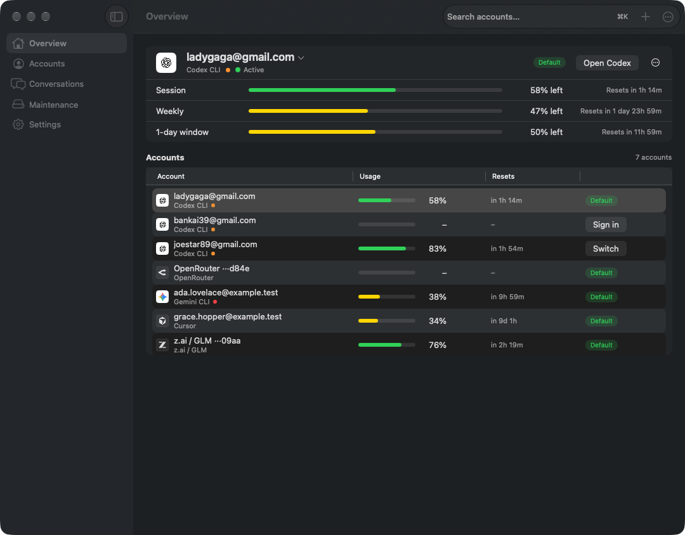
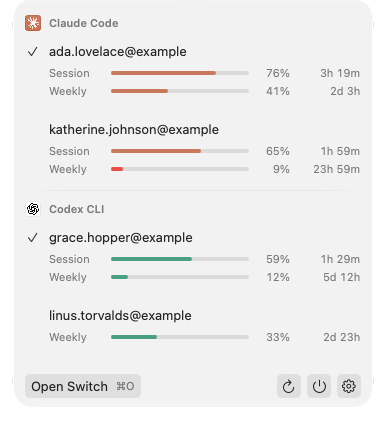
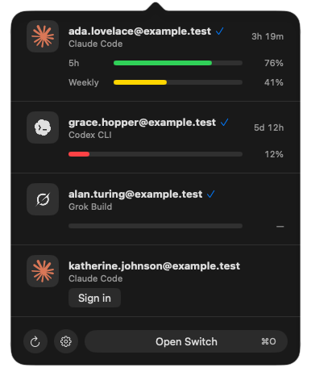
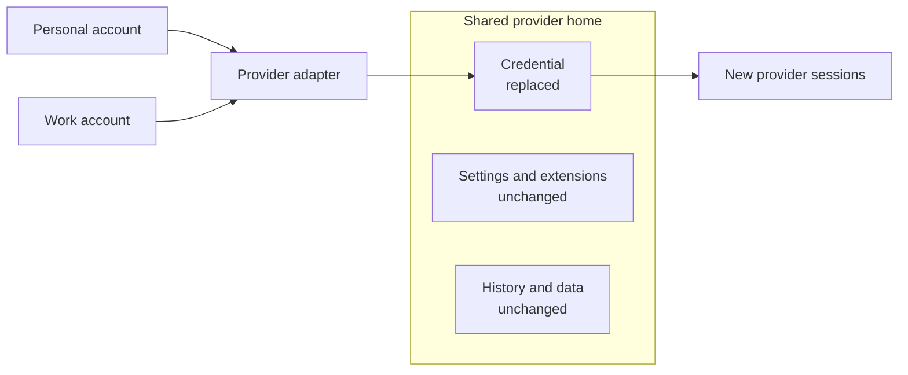

# Switch

**Switch AI accounts without signing in over and over.**

Switch is a native macOS account manager for supported AI coding tools. Keep
multiple logins ready, select an account from the menu bar, and open the right
tool without repeating its sign-in flow.



*Synthetic Preview data. The account names and usage values are examples.*

## Get Switch for Mac

[Download Switch for Mac](https://github.com/surajmandalcell/switch/releases/download/v3.6.1/Switch-v3.6.1-mac-arm64.zip),
unzip it, and move `Switch.app` to Applications. Switch requires macOS 14 or
later on Apple Silicon. Install the command-line tool for each provider you use.

| Provider | Account switching | Usage limits |
| --- | --- | --- |
| Codex CLI | Swaps `~/.codex/auth.json` | Supported |
| [Grok Build](https://github.com/xai-org/grok-build#installing-the-released-binary) | Swaps `~/.grok/auth.json` | Supported |
| Claude Code | Profiles that share one history | Supported |
| Gemini CLI, Antigravity CLI, Cursor, GitHub Copilot, Kiro, Kimi Code, Kilo, Codebuff, Devin, OpenCode Go, Ollama, Vertex AI | Swaps only the tool's login | Supported |
| About 80 API and plan providers, such as OpenRouter, z.ai, DeepSeek, MiniMax, Mistral, Groq, OpenAI, AWS Bedrock, Warp, and Factory | Switches the saved key or session | Supported |

Switch includes every usage provider from [OpenUsage](https://github.com/robinebers/openusage)
and [CodexBar](https://github.com/steipete/CodexBar) that works without reading the
macOS Keychain or browser cookie stores. Providers that need a browser session take a
pasted Cookie header instead.

You can also [build Switch from source](docs/development.md#build-and-check).

## Use Switch in the terminal

Open the terminal interface without a global install:

```bash
npx --yes @smdl/switch
```

Or install it globally:

```bash
npm install --global @smdl/switch
switch
```

The npm build currently supports Apple Silicon Macs. From a source checkout,
the direct path is:

```bash
make tui
```

The terminal interface uses the same account store and switching engine as the
Mac app. Use the arrow keys to move, Enter to select, and Escape to go back.
The existing `ai-manager` command remains available as an alias. Run
`switch help` for non-interactive commands and JSON output.

## Start switching

Choose **Add Account**, then search for the provider.

1. For a command-line tool, sign in through its isolated temporary home, or
   import the login you already have. For an API provider, paste its key.
2. Return to Switch and choose **Check Now**.
3. Choose **Switch** in the menu bar, or **Set as Default** in the app.
4. Choose **Open** to launch that provider with the selected account.

Sign-in runs in a private temporary home. It does not replace your current
login while you add another account.

## See account status before you switch

The menu bar lists every saved account and the current default for each provider.
Switch also shows each account's limits, reset countdowns, and a pace color that warns
before a window runs out. Codex refreshes every three minutes and other providers every
five. The status item can show up to four account percentages, and the popover lists
every account without inventing unavailable data. Optional notifications warn when a
window is almost out, and a dot marks a provider incident.

| Light | Dark |
| :---: | :---: |
|  |  |

## Only the provider login changes

Switch keeps each provider's settings, extensions, and work history in its shared home.
Selecting an account changes only that provider's credential file, JSON entry, or
database rows. The previous login is saved first, and the replaced bytes are backed up.
Each provider keeps its own default account.



Provider notes:

- **Codex CLI:** Switch replaces only `~/.codex/auth.json`. Existing sessions keep the
  credential they already loaded. Usage limits, history, activity, imports, and Cleanup
  are available.
- **Grok Build:** Switch replaces only `~/.grok/auth.json`. The official CLI reloads that
  file before its next API call.
- **Claude Code:** Each account is a separate profile with its own
  `CLAUDE_CONFIG_DIR`, so several can stay signed in. All profiles share the
  conversations, settings, commands, and skills in `~/.claude`. The default applies to
  sessions launched through Switch. Turn on **Use the selected Claude account in
  terminals** in Settings to make a plain `claude` command follow it.
- **Other command-line tools:** Switch swaps only the tool's login file, JSON entry, or
  database rows. Quit an app such as Cursor before switching it.
- **API providers:** Each account is a saved key or pasted session. Switching changes the
  default that the menu bar shows.

## More when you need it

- **Check a saved account.** Validate its credential without making it the default, and
  refresh usage when the provider exposes it.
- **Import an existing account.** Review a credential or provider home before adding it.
  Extra settings and history remain optional where supported.
- **Explore supported history.** Search conversations, track daily token activity, and
  retain summaries when the provider supplies compatible data.
- **Clean up safely.** Preview supported conversations and caches, move them to
  recoverable trash, and restore them when needed.

- **Script it.** `switch usage --json` prints every account's limits, and
  `switch guard --provider codex --min-remaining 10` exits non-zero when a window runs low.

For sample accounts without real credentials, use the
[isolated Preview build](docs/development.md#preview-with-sample-accounts).
[Development and release notes](docs/development.md) cover packaging and
safety. The [product specification](specs/product.md) defines current
behavior. Local ignored goal ledgers record current work and old verification.
